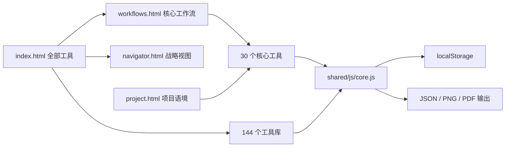

# Architecture

> [CX] 更新：2026-08-13

## 运行模型

项目是无构建步骤的静态 Web 应用。页面通过共享设计令牌、共享运行时和少量页面脚本组成；本地 HTTP 服务是开发与测试的标准入口。

`modiqi.com` WordPress 主站不在上述运行链中。它负责内容、获客和服务转化，通过公开目录契约链接独立工具箱；工具箱不依赖 WordPress 登录、数据库或页面可用性。完整边界见 [`TECHNICAL_ARCHITECTURE_AND_MAINTENANCE.md`](TECHNICAL_ARCHITECTURE_AND_MAINTENANCE.md)。

## 事实来源

| 数据 | 文件 | 约束 |
|---|---|---|
| 工具库存、标题、等级 | `data/tools.json` | 由 `scripts/sync_tool_manifest.py` 生成并校验 |
| 核心工作流 | `data/workflows.json` | 6 条工作流必须恰好覆盖 30 个 core 工具 |
| 主站公开目录契约 | `data/marketing-catalog.json` | 由工具与工作流清单生成；不表示 WordPress 页面已发布 |
| 项目语境 | `modiqi_project_context_v1` | 浏览器本地 JSON |
| 工作流进度 | `modiqi_workflow_progress_v1` | 浏览器本地 JSON |
| 工具字段 | `modiqi_<tool-id>_*` | 由 `shared/js/core.js` 保存 |
| 跨工具战略字段 | `modiqi_strategic_clipboard` | 仅带 `data-strategic-id` 的字段参与 |

## 共享运行时

`shared/js/core.js` 负责自动保存、主题、字体缩放、工具栏、导入导出、打印、图片输出、内容清洗、键盘点击兼容和战略字段同步。页面级计算逻辑仍保留在各工具 HTML 或模块脚本中。

## 依赖策略

Lucide、html2canvas 和 SortableJS 固定版本安装为开发依赖，再由 `scripts/sync_vendor_assets.py` 复制到 `shared/vendor/`。发布页面不得从 CDN 执行脚本。字体使用系统回退栈，不阻塞离线使用。

## 发布面与历史面

发布检查覆盖根入口、工作流、项目页、文档页、报告生成器、14 个当前模块入口和 144 个工具页面。`shared/templates/`、`shared/design-guide/` 与 6 个 `strategy-toolkit/index_v*` 是源模板或历史候选，不属于当前发布面。
