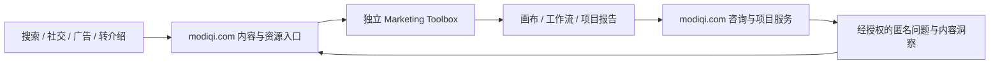

# Marketing Toolbox Long-term Project Charter

> [CX] 版本：1；日期：2026-08-13  
> 状态：长期项目约定。候选域名、价格、服务承诺和公开案例仍需单独审批。

## 1. 项目身份

Marketing Toolbox 是莫蒂奇数字技术（苏州）有限公司长期维护的独立产品，不是 `modiqi.com` 的 WordPress 插件、页面集合或后台模块。

它面向营销顾问、品牌团队和中小企业负责人，提供 local-first、可打印、可复核的营销项目工作台。当前产品面包含 144 个工具，其中 30 个核心工具按 6 条工作流承担正式支持；其余 114 个工具属于扩展库，不默认获得相同的业务方法、样本和发布承诺。

长期价值来自以下资产，而不是工具数量：

- 由业务问题进入并形成交付物的工作流；
- 可追溯的事实、假设、待验证项和复核状态；
- 稳定的项目、工具、工作流和报告数据契约；
- 经领域复核的计算方法、完成规则和业务样本；
- 用户控制的本地数据、导入导出和打印能力；
- 主站内容、搜索入口、服务转化与独立工具之间的可度量链路。

## 2. 系统边界

### 2.1 Marketing Toolbox 负责

- 运行工具、画布、工作流、项目语境和报告生成；
- 保存浏览器本地项目数据并提供用户主动导入、导出、打印；
- 校验工具输入、方法、完成条件、证据状态和上下游交接；
- 维护 30 个核心工具的发布标准和 114 个扩展工具的目录状态；
- 产生不依赖 WordPress 的可用体验。

### 2.2 `modiqi.com` WordPress 主站负责

- 品牌说明、搜索内容、社交和广告承接；
- 工具资源页、工作流专题、问题型文章和服务落地页；
- 将合适访客引导到独立工具箱；
- 在用户完成评估或交付物后承接咨询、培训和项目服务意向；
- 管理公开内容的编辑、审核、结构化数据、canonical 和更新周期。

### 2.3 明确不做

- WordPress 不读取画布内容、项目证据、工作流进度或本地导出文件；
- 两套系统不共享登录、业务数据库、客户表、订单表或 `localStorage`；
- 工具箱不因主站不可用而停止核心功能；
- 主站不复制工具运行逻辑，不把 144 个工具嵌入 WordPress 后台维护；
- 未明确权限、留存、审计、删除和安全模型前，不引入账户、云同步或多人协作；
- 不用批量低质量页面代替真实方法、示例和领域复核。

## 3. 产品结构和支持承诺

| 层级 | 数量 | 角色 | 长期承诺 |
|---|---:|---|---|
| 工作流 | 6 | 由问题到可评审交付物 | 维护顺序、交接、完成条件和报告输出 |
| 核心工具 | 30 | 正式支持面 | 方法、证据、样本、浏览器、打印、导入导出和领域复核逐级达标 |
| 扩展工具 | 114 | 探索与长尾能力 | 保证目录可发现和基础运行；按使用、搜索和业务价值晋级 |
| 项目包 | 候选 | 咨询与服务商品 | 以工作流、核心工具、示例、验收和报告组成，不以单页访问权计价 |

核心工具 readiness 以 [`CORE_TOOL_STANDARD.md`](CORE_TOOL_STANDARD.md) 和 `data/core-readiness.json` 为准。页面能打开只表示运行烟测，不表示业务公式正确、已完成领域评审或适合公开承诺。

## 4. 莫蒂奇增长闭环

该闭环不是数据回传许可。默认只测量页面和导航事件；任何来自画布或报告内容的研究样本都必须由用户主动提供、去标识化并单独授权。

## 5. 决策原则

1. **先修方法与工作流，再扩充数量。** 新增工具必须证明现有工具不能覆盖的业务问题。
2. **先本地、后云端。** 云功能必须有真实协作需求、威胁模型、数据分类、删除机制和预算。
3. **先证据、后结论。** 报告只能汇总已确认且带来源的结论；假设和待验证项必须保持可见。
4. **先核心、后长尾。** 30 个核心工具先达到 `fixture`、`reviewed` 和 `release`，扩展工具按证据晋级。
5. **一个事实来源。** 工具、工作流、合同、内容入口和指标分别使用版本化机器清单，不手工维护互相冲突的副本。
6. **内容服务用户问题。** 资源页解释何时、为何、如何使用工具；文章解决问题；落地页承接工作流或服务，而不是为 SEO 机械复制页面。
7. **不把候选写成上线。** 本地构建、HTTP 200、静态检查和合成样本不能证明公开部署、客户价值或商业验证。

## 6. 治理和责任

长期维护至少需要以下责任，不要求一人只承担一个角色，但每次发布必须能找到负责人：

| 责任 | 最低职责 |
|---|---|
| 产品负责人 | 范围、优先级、支持层级、停止条件 |
| 领域负责人 | 方法、公式、术语、业务样本和错误边界复核 |
| 工程负责人 | 架构、依赖、安全、可访问性、浏览器与发布门禁 |
| 内容负责人 | 主站资源页、问题集群、内链、更新和陈旧内容处理 |
| 数据负责人 | 清单、schema、事件字典、质量、保留和隐私 |
| 服务负责人 | 项目包范围、资格判断、交付标准和客户反馈闭环 |

公开内容、核心方法、数据契约和事件定义的变更应接受评审。破坏性数据变化必须提升 schema 主版本并提供迁移与回滚说明。

## 7. 阶段路线

### 阶段 A：稳定基础

- 维持 144 个桌面、移动和核心打印布局检查；
- 完成共享证据与工作流交接原语；
- 将 30 个核心工具从 `smoke` 推进到 `contract` 和 `fixture`；
- 建立内容目录契约、事件字典和隐私基线。

### 阶段 B：形成可交付工作流

- 逐条完成 6 个工作流的领域评审；
- 让工作流输出带来源、状态、负责人和复核日期的报告；
- 为 30 个核心工具建立完整主站资源页；
- 发布工作流专题和第一批问题型深度文章。

### 阶段 C：验证增长与服务

- 以匿名聚合指标验证资源页到工具使用、工作流完成和服务意向；
- 用真实、获授权的项目样本验证 6 类项目包候选；
- 根据搜索需求、使用深度和服务价值晋级扩展工具；
- 对低价值、重复或长期无人维护的扩展工具合并、冻结或退役。

### 阶段 D：谨慎扩展协作能力

只有在本地版本无法满足经验证的多人协作场景时，才评估账户、加密同步、团队权限和审计。该阶段不是默认路线，也不得阻塞 local-first 核心体验。

## 8. 长期成功指标

项目同时观察产品质量、用户成果、内容获客和服务转化，不能用页面数量代替成功：

- 30 个核心工具各 readiness 等级及停留时间；
- 6 个工作流开始、有效推进、完成和报告导出比例；
- 核心资源页进入工具、工具返回服务页的有效访问；
- 用户能够识别并修复的证据缺口、矛盾和不完整项；
- 主站问题集群的非品牌搜索入口和助攻转化；
- 经资格确认的咨询线索、项目启动和复购；
- 缺陷恢复时间、回归率、数据迁移成功率和陈旧内容比例。

指标定义、采集边界和隐私要求见 [`MODIQI_COM_GROWTH_AND_CONTENT_SYSTEM.md`](MODIQI_COM_GROWTH_AND_CONTENT_SYSTEM.md)；技术与维护边界见 [`TECHNICAL_ARCHITECTURE_AND_MAINTENANCE.md`](TECHNICAL_ARCHITECTURE_AND_MAINTENANCE.md)。

## 9. 变更与退出条件

- 项目定位、系统边界、支持层级或数据默认值改变时，更新本文件并记录迁移影响。
- 某工具连续两个评审周期无独特业务问题、无使用证据且维护成本高于价值时，进入合并或退役评审。
- 某项目包没有真实购买者、交付闭环或可复核结果时，只保留为候选，不公开承诺。
- 任何需要收集个人信息、客户机密或画布内容的功能，在隐私、安全和删除机制获批前保持 `BLOCKED`。
